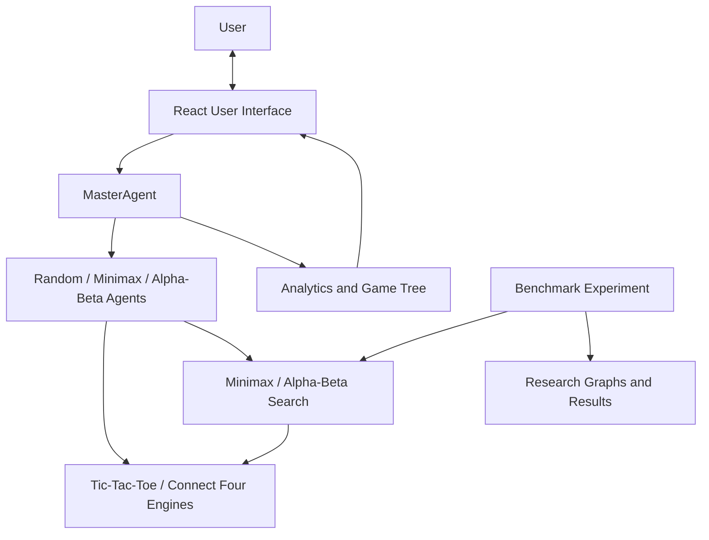

# NEURALTAC — System Architecture

## Architecture Overview

NEURALTAC is a browser-based React application with Tic-Tac-Toe and Connect Four. The UI manages game state and requests AI decisions through MasterAgent. MasterAgent selects a registered Random, Minimax, or Alpha-Beta agent according to the game policy, then validates the returned move. Game-specific engines provide legal moves and terminal-state checks; Connect Four additionally supplies depth-limited search and heuristic evaluation.

## Architecture Diagram

## Component Responsibilities

### 1. React User Interface
Provides the game board, player-mode controls, difficulty selection, scores, move history, analysis controls, and game-tree visualization.

### 2. MasterAgent and agents
MasterAgent registers the concrete agents, resolves a policy, delegates a decision, validates its move, and reports telemetry. RandomAgent chooses a legal move; MinimaxAgent and AlphaBetaAgent delegate to the game-specific search implementations.

### 3. Game engines and search
The Tic-Tac-Toe engine supplies the 3 × 3 rules and terminal-state evaluation. Connect Four uses a 6 × 7 grid, gravity, depth-limited Minimax/Alpha-Beta, and a non-terminal heuristic. Tic-Tac-Toe search is exhaustive.

### 4. Analytics and Game Tree
Displays search statistics and visualizes game-tree information for analysis.

### 5. Benchmark Experiment
Runs selected board positions through both algorithms, records node counts and execution times, and compares their results.

### 6. Research Graphs and Results
Contains the generated PNG graphs and benchmark CSV/JSON files used for experimental analysis.

## Data Flow

1. The user selects a mode, policy, or makes a move through the React interface.
2. The game-specific engine provides valid actions and game status.
3. When the AI must move, MasterAgent resolves the policy and delegates to a registered agent.
4. Search agents call their game's algorithm; MasterAgent validates the selected move before the UI applies it.
5. Analysis and benchmarking run separate read-only comparisons; they are not normal gameplay calls.
6. The recorded benchmark results are summarized in tables, graphs, and the experimental-results document.

## Implementation Note

The game-tree and analysis views summarize candidate evaluations and predicted lines; they do not render every node visited by a search. Alpha-Beta's pruned-sibling telemetry counts skipped immediate siblings at cutoffs, not all descendant nodes beneath them. Connect Four currently has no Undo control; use Reset board to restart.