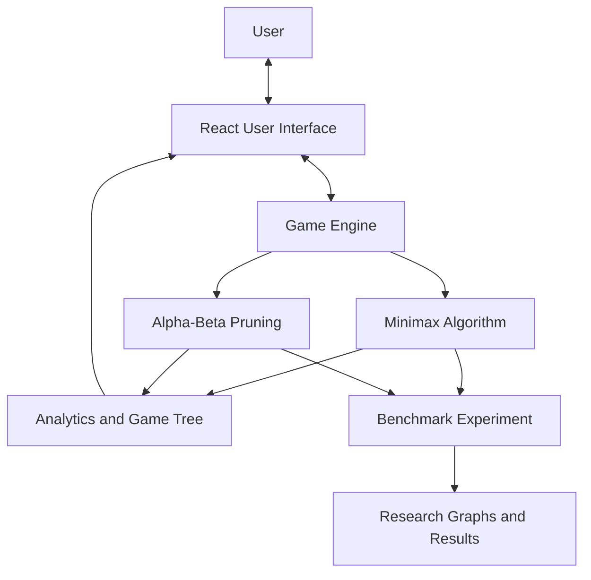

# NEURALTAC — System Architecture

## Architecture Overview

NEURALTAC is a browser-based Tic-Tac-Toe application built with React. The interface interacts with the game engine to maintain board state, validate moves, detect game outcomes, and request AI decisions. The AI layer contains Minimax and Alpha-Beta Pruning. A benchmarking utility compares their search behavior, and the application displays analytics and game-tree information.

## Architecture Diagram

## Component Responsibilities

### 1. React User Interface
Provides the game board, player-mode controls, difficulty selection, scores, move history, analysis controls, and game-tree visualization.

### 2. Game Engine
Creates the initial board, generates legal moves, applies moves, and determines whether the game is ongoing, won, or drawn.

### 3. Minimax Algorithm
Explores possible game states and selects a move according to minimax evaluation, assuming optimal play by both players.

### 4. Alpha-Beta Pruning
Performs minimax search while pruning branches that cannot affect the final minimax decision.

### 5. Analytics and Game Tree
Displays search statistics and visualizes game-tree information for analysis.

### 6. Benchmark Experiment
Runs selected board positions through both algorithms, records node counts and execution times, and compares their results.

### 7. Research Graphs and Results
Contains the generated PNG graphs and benchmark CSV/JSON files used for experimental analysis.

## Data Flow

1. The user selects a mode or makes a move through the React interface.
2. The game engine validates the state and determines available actions.
3. When the AI must move, the selected search algorithm evaluates legal moves.
4. The chosen move updates the board and the interface displays the new state.
5. For research, the benchmark experiment evaluates selected positions using both algorithms.
6. The recorded results are summarized in tables, graphs, and the experimental-results document.

## Implementation Note

The diagram is a high-level conceptual representation. Before final submission, verify each connection against the source code. In particular, the offline benchmark script and generated research files are separate from the interactive game interface, even though both belong to the same project.